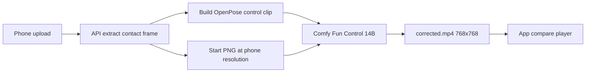

# Submission mosaic — look here first

Clip under review: `/home/shini/Downloads/corrected.mp4` (downloaded from the phone / compare flow).

## What this clip already tells us

Do not change code yet. Confirm or rule out each assumption below against a **new** generation after you finish your checks.

| Fact | Value |
|---|---|
| Size / length | `768x768`, `33` frames, `16` fps (~2.06s) |
| Models in the embedded Comfy prompt | `wan2.2_fun_control_high_noise_14B_bf16.safetensors`, `wan2.2_fun_control_low_noise_14B_bf16.safetensors`, `umt5_xxl_fp8_e4m3fn_scaled.safetensors`, `wan_2.1_vae.safetensors` |
| Sampler settings in the prompt | high + low `KSamplerAdvanced` `steps=20`, `cfg=3.5`, `ModelSamplingSD3 shift=8` |
| Look | Full-frame “stained glass” / token lattice (~16 px cells) on skin, court, wall, clothes — same class as [README.md](./README.md) |
| Not matching local upload hashes | This file’s sha256 is `ae3eacc2…`. None of the `server/uploads/technique-correction-videos/*/corrected.mp4` on the 5090 box match it, so it may be from Railway → a remote Comfy, an older local run that was deleted, or another machine. Trace the analysis id before blaming the box alone. |
| Local Fun Control weights (now) | On the 5090 box, both UNets currently match the good checksums in [kyle-checklist.md](./kyle-checklist.md). If this clip is still mosaic, either it was made **before** the re-download, or it was made on a **different** Comfy that still has bad weights. |

Tin’s earlier finding still stands for the box: damaged 14B files produced lattice; re-download cleaned the same workflow. A small start frame / weak pose still causes melted faces and soft hands after the lattice is gone — that is a separate quality track.



---

## Kyle — 5 places to look (ops / which Comfy actually ran)

### K1. Which Comfy host wrote this file?

Assumption: Railway or the phone hit a Comfy that is **not** the freshly fixed 5090 box.

- Find the analysis id for this clip (app history, API logs, or `technique_analysis.metrics` / correction-video URL).
- Check Railway `COMFYUI_BASE_URL` and local `server/.env` `COMFYUI_BASE_URL`. Confirm they point where you think (ngrok Comfy vs something else).
- If Railway still points at an old tunnel or a second machine, mosaic can persist even when the box is clean.

### K2. Re-check Fun Control weights on the machine that generated it

Assumption: the host that ran this prompt still has damaged high/low noise files (or a half-written re-download).

On that host:

```bash
cd /home/shini/ComfyUI/models/diffusion_models
sha256sum wan2.2_fun_control_high_noise_14B_bf16.safetensors \
  wan2.2_fun_control_low_noise_14B_bf16.safetensors
```

Expected (from [kyle-checklist.md](./kyle-checklist.md)):

```
e4be07ca25d67aaf3461ef87fbb5ad8762f602a5efa620aea9dc250ac2747a9d  ...high_noise...
d82bc21cd703e089eee4f6fabc25e90ebbd00965623fdc5e83d46d01dbeac2c3  ...low_noise...
```

Also spot-check `umt5_xxl_fp8_e4m3fn_scaled.safetensors` and `wan_2.1_vae.safetensors` against Hugging Face.

### K3. Force a brand-new generation after checksums pass

Assumption: the phone is still playing a **cached** mosaic file from before the re-download.

- Trigger correction video with `forceRegenerate` (or delete the cached `corrected.mp4` for that analysis).
- Confirm the new file’s sha256 differs from `ae3eacc2…`.
- Open mid-frame crops: lattice gone vs still present.

### K4. Confirm high-noise and low-noise are not the same file

Assumption: both UNet slots are somehow the same weights (known Wan lattice failure mode; already partly ruled out on the box, still worth one check on whatever host served this clip).

- Compare inode / sha256 of the two files.
- In Comfy history for the job, confirm node `101` = high, `102` = low (this clip’s prompt already shows that mapping).

### K5. Separate lattice from “soft face / smear”

Assumption: after lattice is gone, people still call the result “mosaic” when the start frame is tiny (~player ~70 px wide) and the model invents texture at 768.

- Measure short side of the **start PNG** used for this analysis (`extractFrame` output).
- If short side ≪ 720 (`MIN_RECOMMENDED_SHORT_SIDE`), treat remaining smear as input resolution, not damaged weights.
- Do not re-download models for smear alone.

---

## Tin / other dev — 5 places to look (pipeline / workflow / inputs)

### T1. Start-frame path in the submission flow

Assumption: mosaic (or the soft follow-on) is amplified because production still sends a full-court contact PNG stretched onto 768, not a player crop.

Look (read-only first):

- `server/src/technique/techniqueRouter.ts` — `extractFrame(videoPath, frameRow.frame)` → `imageBuffer` into `generatePoseRetargetVideoComfy`
- Whether any crop / face-ref step from `comfyui-deploy/make_face_crops.py` is wired (today: tooling only, not on the live path)

Check: dump the start image for this analysis next to the corrected mp4. If the player is a small blob, document that as input quality, not model corruption.

### T2. Control / pose clip quality

Assumption: a bad or empty pose clip changes motion but Tin already saw lattice with **no** pose; still verify this submission did not send a broken control video that confuses debugging.

Look:

- `server/src/technique/openPoseVideo.ts` — control canvas `DEFAULT_SIZE` 768, `correctionFunLength()` 33, `correctionFunFps()` 16
- Pose alignment helpers (`pickImpactAlignedProPoseFrame`, mirroring)

Check: save the control mp4 Comfy received for this job and scrub it. Lattice on the **output** with a clean control still points at weights/runtime, not pose.

### T3. Fun Control workflow JSON vs what Comfy executed

Assumption: Railway / local `COMFYUI_FUN_CONTROL_WORKFLOW_PATH` points at a different graph than the one Tin validated clean on RunPod (`docs/texture-investigation/runpod-2026-10-01/wf_bf16.json`).

Look:

- Env `COMFYUI_FUN_CONTROL_WORKFLOW_PATH`
- `Workflows/video_wan2_2_fun_control*.api.json` / `workflows/video_wan2_2_fun_control*.api.json` in FAXevo
- Diff node wiring for high/low split (this clip: nodes `96` then `95`, shifts 8, length 33)

Check: byte-compare or node-diff the embedded prompt in `corrected.mp4` (format tag `prompt`) against the clean RunPod workflow.

### T4. Canvas / length / provider env on the server that served the phone

Assumption: something other than Fun Control 14B bf16 ran in production (TI2V 5B, Gemini, fp8 workflow, different `CORRECTION_CANVAS_SIZE`) and we are comparing apples to oranges.

Look:

- `XEVO_VIDEO_PROVIDER`, `COMFYUI_FUN_CONTROL_WORKFLOW_PATH`, `COMFYUI_VIDEO_WORKFLOW_PATH`
- `CORRECTION_CANVAS_SIZE`, `CORRECTION_FUN_LENGTH`, `CORRECTION_FUN_FPS`
- Branch in `comfyVideo.ts`: `generatePoseRetargetVideoComfy` vs TI2V / Gemini

This clip’s metadata says Fun Control 14B bf16 @ 768 / 33 — so for **this** file the provider path is Fun Control. Confirm the next phone submission still hits the same path.

### T5. App playback vs true file contents

Assumption: the Expo compare player (`COVER`, dual `expo-av`, drag overlay) makes lattice look worse, or shows an old cached URI.

Look:

- `app/src/components/CorrectionVideoCompare.tsx` — display only; does not re-encode
- Whether the phone URL is ngrok API (5090 box) or Railway production
- CDN / local cache of `corrected.mp4` after regenerate

Check: open the raw mp4 outside the app (as with this Downloads file). If lattice is in the file, the player is not the cause.

---

## Suggested order (both)

1. Kyle K1 + K2 — which machine, checksums.  
2. Kyle K3 — new generate; stop if clean.  
3. Tin T3 + T4 — workflow/env match the clean RunPod case.  
4. Tin T1 + Kyle K5 — if lattice gone but faces melt, move to crop / Animate path (models already on the box; workflow in FAXevo, not wired to the phone yet).  
5. Only then consider Comfy/PyTorch version pins ([kyle-checklist.md](./kyle-checklist.md) step 3).

## Out of scope for this pass

- Expo UI / Chalyn shot picker (unrelated to lattice).  
- Club-router / password-reset merges.  
- Changing Fun Control prompts or core gen code until K1–K3 are answered.
